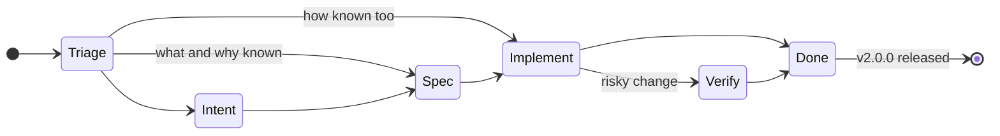

# Backlog

Ideas, feedback and bugs, tracked from triage until they ship. Each item
stays short (at most 3 sentences): the detail, open questions and research go
in its intent once it's scoped.

Each item carries a stage label, for the step it has reached:

- `Triage`: the item has been created. Every item starts here.
- `Intent`: its `intent/NN_*.md` exists, the what and the why.
- `Spec`: its `specs/NN_*.md` exists, the how.
- `Implement`: the PR with the code changes is open.
- `Verify`: the change needs manual verification before it counts as done.
- `Done`: the code is merged.

A simple item can skip ahead: from `Triage` to `Spec` when the what and why are
already clear, or straight to `Implement` when the how is too. `Verify` is only
for changes risky enough to need it. `Done` items stay until v2.0.0 is
released, then they're removed: their docs and the git history keep the
record.

**v1.0.0** (reached 2026-10-18 with intent 18): a game can be played with only
the physical cards, every hero's needs met. The polish left over from it is
now part of Toward 2.0.

**v2.0.0 goal** (set 2026-10-26): players can play without needing the
rulebook beside them. v1 kept every rule manual (nothing expires, clears or
triggers on its own). v2 looks for the right balance between manual and
automatic: quality-of-life changes and automation where they cut down on human
error, manual control where it keeps the table in charge.

## Bugs

- `Done` **The wrong team's Tower disappeared on the Map.** Player 2's Tower
  was brought to 0 HP, but a Player 1 Tower seemed to disappear from the Map. The
  app had Player 1 on the red base, while the table plays Player 1 as blue.
- `Done` **Swap Player 1's and Player 2's colors.** Player 1 is now blue
  (top-left, forest) and Player 2 red (bottom-right, desert), on the Draft, Board,
  Map and structure icons. Fixed together with the Tower bug above (v1.0.1).

## Toward 2.0

### Triage

- `Triage` **Automate the other steps when a phase starts.** Cleanup's 2 gold per
  team is now automatic (intent 25), but a phase's other rulebook steps are still
  done by hand. Each one has to be undone when the phase control steps back.
- `Triage` **Show token and Artifact rules in the app, not in a tooltip.** Runika's
  Artifact bonuses only show on hover, which is easy to miss. Show them, and
  what every token does, somewhere visible so nobody needs the rulebook.
- `Triage` **Merge the Battle Board and the Battle Map into one screen.** Players keep
  switching between them, since each shows half the game. At least keep the
  Map visible at all times.
- `Triage` **Review every token's display together.** Every token now exists, but
  each was designed on its own. Review the Board's token row and picker, colors
  and icons, the Map's status panel and Runika's Artifacts for one consistent
  look.
- `Triage` **A board-game, high-fantasy look.** The app doesn't feel like a board
  game or like Biternia's medieval world. Give every screen a theme that does.
- `Triage` **Hide an empty respawn area on the Map.** It takes room even when no
  hero is defeated. It still has to show at battle start and as a drop target
  while dragging.
- `Triage` **Move the gold-pile controls off the Map.** The gold-pile steppers take
  space under the board. Move them somewhere else so the board can grow.
- `Triage` **Auto-focus the Map's camera.** Have the camera move on its own to where
  the action is, instead of only by hand.
- `Triage` **Defeat and destruction animations.** Animate a hero's defeat and a
  Tower's or Bit's destruction.
- `Triage` **Coin-flip animation at draft start.** Show the initiative coin flip
  instead of just stating the result.
- `Triage` **Turn-passing animation in the draft.** Animate the turn banner and team
  highlight when the pick passes to the other player.
- `Triage` **Level 4 animation.** Animate a hero reaching level 4, the max level,
  so the moment stands out on the Board.

### Done

- `Done` **Add the HP bump on level-up automatically.** Per the rulebook, leveling
  up also raises the hero's HP by one. The app now adds it on level-up (v1.1.0).
- `Done` **Team level.** Show each team's level-ups taken (0 to 12) on the Board
  and the Map, to compare both teams at a glance (v1.2.0).
- `Done` **Show the current round and phase.** Show the round and phase (Orders,
  Movement, Action, Cleanup) on the Board and the Map. One control steps through the
  phases, keeping round, phase and initiative in step (v1.3.0).
- `Done` **Take gold on level-up automatically.** Leveling up takes the hero's
  current level plus one in gold, refunded on a level-down. The level is read-only,
  changing one paid step at a time (v1.4.0).
- `Done` **Hero roles in the draft.** Each hero has one role (Damage, Utility or
  Support), and the draft pool can be filtered by role to plan a balanced team
  (v1.5.0).
- `Done` **Give each team its Cleanup gold.** Starting Cleanup adds each team's 2
  gold, and stepping back out of it takes the gold back (v1.6.0).
- `Done` **Show each defeated hero's respawn window.** A defeated hero shows the
  rounds in which its card can come back, estimated from the deck. It replaced the
  idea of showing the round it fell (v1.7.0).
